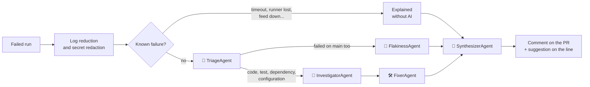

# CI Failure Crew

**English** | [Português](README.pt-BR.md) | [简体中文](README.zh-CN.md)

[](https://github.com/Cosmess/ci-failure-crew/actions/workflows/ci.yml)


When CI fails on a pull request, a **crew of AI agents** reads the job logs and the diff, finds the line that broke
the build, and comments on the pull request: *"The test X failed because the change in line Y does Z"*, with the fix
as a suggestion you can commit in one click. Built with .NET 10 and the
[Microsoft Agent Framework](https://github.com/microsoft/agent-framework).


<sub>Real explanation on the [demo pull request](https://github.com/Cosmess/ci-failure-crew/pull/10): the cause, the line and a one-click fix.</sub>

## How it works



| Agent | Responsibility |
|---|---|
| **TriageAgent** | Classifies the failure: compilation, test, flaky test, dependency, infrastructure, timeout or configuration |
| **FlakinessAgent** | When the job also fails on the default branch, decides whether the test is flaky or the change broke it |
| **InvestigatorAgent** | Connects the error to the line of the diff that caused it, reading the repository when needed |
| **FixerAgent** | Proposes the smallest fix, checked against the expected values in the log; one-line fixes become suggestions |
| **SynthesizerAgent** | Writes the one-sentence headline over every failed job |

Only the agents a failure needs are called. Failures with a known cause (job timeout, runner lost, disk full, out of
memory, package feed down, rate limits) are explained by rules, **without calling a model**.

## Features

- **Points to the line**: the comment shows the file and line of the cause and whether the pull request caused it.
- **One-click fixes**: fixes that fit on a line of the diff are posted as GitHub suggestions.
- **One comment per workflow**: updated on every run instead of piling up, and marked as resolved when CI passes again.
- **Flaky test detection**: compares with the same job's recent runs on the default branch.
- **Small and safe context**: logs are reduced to the lines that matter and secrets GitHub did not mask are redacted
  before reaching the model or the comment.
- **Safe for forks**: runs on `workflow_run`, so the pull request code is never checked out or executed.
- **Repository context through MCP**: agents can read files and search the code through a read-only MCP server.
- **Multilingual**: explanations in English (default), Brazilian Portuguese or Simplified Chinese.
- **Fast start**: on Linux runners the Action pulls a prebuilt image and starts in seconds.
- **Measured quality**: an evaluation suite with labeled failed runs.
- **Provider-agnostic CLI**: OpenAI by default; Anthropic Claude and Ollama also supported.

## Quick start (GitHub Action)

1. Add an `OPENAI_API_KEY` secret to your repository (*Settings → Secrets and variables → Actions*).
2. Create `.github/workflows/ci-failure-crew.yml`, naming the workflows to watch in `workflows`:

```yaml
name: CI Failure Crew

on:
  workflow_run:
    workflows: [CI]
    types: [completed]

permissions:
  actions: read
  contents: read
  pull-requests: write

jobs:
  explain:
    if: github.event.workflow_run.event == 'pull_request' && github.event.workflow_run.conclusion != 'cancelled'
    runs-on: ubuntu-latest
    steps:
      - uses: actions/checkout@v4   # the default branch, never the pull request code
      - uses: Cosmess/ci-failure-crew@v1
        with:
          openai-api-key: ${{ secrets.OPENAI_API_KEY }}
          language: en   # en, pt-BR or zh-CN
```

`workflow_run` workflows only run from the default branch, so merge this file before testing it on a pull request.

| Input | Default | Description |
|---|---|---|
| `openai-api-key` | required | OpenAI API key |
| `github-token` | `github.token` | Token to read the run and its logs and to comment on the pull request |
| `model` | `gpt-5-mini` | OpenAI model |
| `language` | `en` | Explanation language: `en`, `pt-BR` or `zh-CN` |
| `config` | `.ci-failure-crew.yml` | Configuration file (ignored if missing) |
| `run-id` | the triggering run | Workflow run to explain |
| `post-comment` | `true` | Comment on the pull request and mark it resolved when CI passes |
| `read-repository` | `true` | Give the agents read-only MCP tools over the checked-out repository |

More in the [GitHub Action guide](docs/en/guides/github-action.md): several workflows, private repositories, forks
and other runners.

## Command line

Requirements: [.NET 10 SDK](https://dotnet.microsoft.com/download) and an [OpenAI API key](https://platform.openai.com/api-keys).

```bash
git clone https://github.com/Cosmess/ci-failure-crew.git
cd ci-failure-crew
export OPENAI_API_KEY=sk-...

# Explain a log and the diff that broke it
dotnet run --project src/CiFailureCrew.Cli -- --log samples/test.log --diff samples/test.diff

# Explain a failed run of a repository and comment on its pull request (needs GITHUB_TOKEN)
dotnet run --project src/CiFailureCrew.Cli -- --run 1234567890 --repo owner/repo --post
```

| Option | Description |
|---|---|
| `--run <id>` | Workflow run to explain (needs `GITHUB_TOKEN` with `actions: read`) |
| `--repo <owner/name>` | Repository of the run (default: `GITHUB_REPOSITORY`) |
| `--post` | Comment on the pull request of the run, or mark the comment resolved when the run passed |
| `--log <file>` | Job log to explain instead of a run; repeat it for several jobs |
| `--diff <file>` | Diff of the change, used with `--log` |
| `--language <code>` | Explanation language: `en`, `pt-BR` or `zh-CN` |
| `--repo-path <dir>` | Give the agents MCP tools to read files and search the code |
| `--config <file>` | Configuration (default: `.ci-failure-crew.yml`, if present) |
| `--output <file>` | Save the explanation as Markdown |

| Environment variable | Default | Description |
|---|---|---|
| `OPENAI_API_KEY` | | OpenAI API key (default provider) |
| `CFC_PROVIDER` | `openai` | `openai`, `ollama` or `anthropic` |
| `CFC_MODEL` | `gpt-5-mini` | Model id (e.g. `gpt-5-mini`, `qwen3:8b`, `claude-sonnet-5-5`) |
| `GITHUB_TOKEN` | | Required by `--run` |
| `ANTHROPIC_API_KEY` | | Anthropic key, when `CFC_PROVIDER=anthropic` |
| `OLLAMA_ENDPOINT` | `http://localhost:11434` | Ollama server URL |
| `OTEL_EXPORTER_OTLP_ENDPOINT` | | Export traces and metrics through OTLP |

## Configuration (`.ci-failure-crew.yml`)

```yaml
language: en
maxJobs: 3              # failed jobs analyzed per run; the others are only listed
ignoreJobs: ["deploy*"] # job names never analyzed (* matches any text)
historyRuns: 10         # runs on the default branch checked to detect flaky jobs (0 disables it)
maxLogChars: 20000
maxDiffChars: 40000
agentTimeoutSeconds: 180
maxRetries: 2
pricing:                # US$ per 1 million tokens, to estimate the cost
  inputPerMillion: 0.25
  outputPerMillion: 2.00
```

Every option is documented in [`.ci-failure-crew.example.yml`](.ci-failure-crew.example.yml).

## Evaluation

The crew is measured on 11 labeled failed runs: compilation errors, .NET and Jest test failures, formatting,
configuration, dependencies, a flaky test and infrastructure failures.

| Metric | English | Portuguese |
|---|---|---|
| Category | 100% (11 / 11) | 100% (11 / 11) |
| Root cause located (file and line) | 100% (7 / 7) | 100% (7 / 7) |
| Origin (caused by the pull request or not) | 100% (11 / 11) | 100% (11 / 11) |
| Known failures explained without AI | 100% (3 / 3) | 100% (3 / 3) |
| **Fully correct jobs** | **100% (11 / 11)** | **100% (11 / 11)** |

<sub>`gpt-5-mini`, October 2026, about 3,000 input and 2,000 output tokens per run.</sub>

These cases were written by the maintainers and are cleaner than real CI logs, so a perfect score means the crew
handles the common failures, not that it is always right. The suite does not score the suggested fix: on the
sample in `samples/`, the fix was right in 3 of 3 runs after the fixer learned to check it against the expected
values in the log (1 of 2 before). More and harder cases are welcome.

Run it yourself with `dotnet run --project src/CiFailureCrew.Evals`, or with the **Evaluation** workflow. Details in
[`evals/README.md`](evals/README.md).

## Security

- The Action runs on `workflow_run`: it uses the code and secrets of the default branch and never checks out or runs
  the pull request code, so pull requests from forks are safe.
- Logs and diffs are redacted before reaching the model: tokens, keys, private keys and passwords.
- Logs, diffs and files are treated as data, never as instructions; the repository tools are read-only and confined
  to the repository.
- Comments cannot mention users: `@name` written by the model is neutralized.

See [SECURITY.md](SECURITY.md) to report a vulnerability.

## Project structure

```
src/
  CiFailureCrew.Core/       log analysis, agents, orchestration, GitHub, configuration, localization, rendering
  CiFailureCrew.Providers/  LLM client creation (OpenAI, Anthropic, Ollama)
  CiFailureCrew.Cli/        command line, MCP tools and OTLP export
  CiFailureCrew.McpServer/  read-only MCP server with the repository tools
  CiFailureCrew.Evals/      evaluation runner
evals/cases/                labeled failed runs
samples/                    a failed test log and the diff that caused it
tests/                      unit tests (no network) and integration tests (real model)
docs/                       documentation in English, Portuguese and Chinese, plus ADRs
action.yml                  GitHub Action
Dockerfile                  prebuilt image used by the Action on Linux runners
AGENTS.md                   rules for AI agents working on this repository
```

## Documentation

- [Documentation index](docs/en/README.md): architecture, coding standards, testing and guides
- [Architecture decision records](docs/adr/)

## Roadmap

- [x] Known failure rules, triage, flakiness check, investigation and fix
- [x] Sticky pull request comment, one-click suggestions and resolution when CI passes
- [x] GitHub Action with a prebuilt image
- [x] Evaluation suite with labeled failed runs
- [x] Explanations in English, Portuguese and Chinese
- [ ] More log formats (Gradle, Maven, Go, Rust) and more known failure rules
- [ ] Open a pull request with the fix when it spans several lines

## Related

[Code Review Crew](https://github.com/Cosmess/code-review-crew): the same idea applied to code review, with security,
OWASP, performance and style agents.

## Contributing

Contributions are welcome: see [CONTRIBUTING.md](CONTRIBUTING.md). Report vulnerabilities privately, as described in
[SECURITY.md](SECURITY.md). Changes are listed in the [changelog](CHANGELOG.md).

## License

[MIT](LICENSE)
