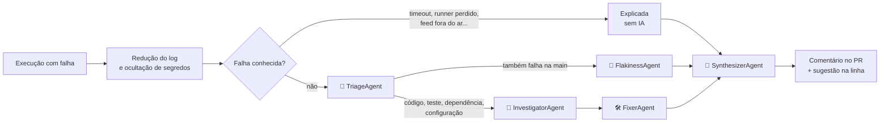

# CI Failure Crew

[English](README.md) | **Português** | [简体中文](README.zh-CN.md)

[](https://github.com/Cosmess/ci-failure-crew/actions/workflows/ci.yml)


Quando o CI falha num pull request, uma **equipe de agentes de IA** lê os logs dos jobs e o diff, encontra a linha
que quebrou o build e comenta no pull request: *"O teste X falhou porque a mudança na linha Y faz Z"*, com a correção
como sugestão que você aplica com um clique. Construído com .NET 10 e o
[Microsoft Agent Framework](https://github.com/microsoft/agent-framework).


<sub>Explicação real no [pull request de demonstração](https://github.com/Cosmess/ci-failure-crew/pull/10): a causa, a linha e a correção com um clique.</sub>

## Como funciona



| Agente | Responsabilidade |
|---|---|
| **TriageAgent** | Classifica a falha: compilação, teste, teste instável, dependência, infraestrutura, timeout ou configuração |
| **FlakinessAgent** | Quando o job também falha na branch padrão, decide se o teste é instável ou se a mudança o quebrou |
| **InvestigatorAgent** | Liga o erro à linha do diff que o causou, lendo o repositório quando precisa |
| **FixerAgent** | Propõe a menor correção, conferida contra os valores esperados no log; correções de uma linha viram sugestões |
| **SynthesizerAgent** | Escreve a frase de abertura sobre todos os jobs que falharam |

Só os agentes de que a falha precisa são chamados. Falhas de causa conhecida (timeout do job, runner perdido, disco
cheio, falta de memória, feed de pacotes fora do ar, limite de taxa) são explicadas por regras, **sem chamar o
modelo**.

## Funcionalidades

- **Aponta a linha**: o comentário mostra o arquivo e a linha da causa e se o pull request a causou.
- **Correção com um clique**: correções que cabem numa linha do diff são publicadas como sugestões do GitHub.
- **Um comentário por workflow**: atualizado a cada execução em vez de acumular, e marcado como resolvido quando o
  CI volta a passar.
- **Detecção de testes instáveis**: compara com as execuções recentes do mesmo job na branch padrão.
- **Contexto pequeno e seguro**: os logs são reduzidos às linhas que importam, e segredos que o GitHub não mascarou
  são ocultados antes de chegar ao modelo ou ao comentário.
- **Seguro para forks**: roda em `workflow_run`, então o código do pull request nunca é baixado nem executado.
- **Contexto do repositório via MCP**: os agentes leem arquivos e buscam código por um servidor MCP somente leitura.
- **Multilíngue**: explicações em inglês (padrão), português do Brasil ou chinês simplificado.
- **Início rápido**: em runners Linux, a Action baixa uma imagem pronta e começa em segundos.
- **Qualidade medida**: uma suíte de avaliação com execuções com falha rotuladas.
- **CLI independente de provedor**: OpenAI por padrão; Anthropic Claude e Ollama também são suportados.

## Início rápido (GitHub Action)

1. Crie o secret `OPENAI_API_KEY` no repositório (*Settings → Secrets and variables → Actions*).
2. Crie `.github/workflows/ci-failure-crew.yml`, com os nomes dos workflows a observar em `workflows`:

```yaml
name: CI Failure Crew

on:
  workflow_run:
    workflows: [CI]
    types: [completed]

permissions:
  actions: read
  contents: read
  pull-requests: write

jobs:
  explain:
    if: github.event.workflow_run.event == 'pull_request' && github.event.workflow_run.conclusion != 'cancelled'
    runs-on: ubuntu-latest
    steps:
      - uses: actions/checkout@v4   # a branch padrão, nunca o código do pull request
      - uses: Cosmess/ci-failure-crew@v1
        with:
          openai-api-key: ${{ secrets.OPENAI_API_KEY }}
          language: pt-BR   # en, pt-BR ou zh-CN
```

Workflows de `workflow_run` só rodam a partir da branch padrão: mescle este arquivo antes de testar num pull request.

| Input | Padrão | Descrição |
|---|---|---|
| `openai-api-key` | obrigatório | Chave da API da OpenAI |
| `github-token` | `github.token` | Token para ler a execução e seus logs e comentar no pull request |
| `model` | `gpt-5-mini` | Modelo da OpenAI |
| `language` | `en` | Idioma da explicação: `en`, `pt-BR` ou `zh-CN` |
| `config` | `.ci-failure-crew.yml` | Arquivo de configuração (ignorado se não existir) |
| `run-id` | a execução que disparou | Execução a explicar |
| `post-comment` | `true` | Comenta no pull request e marca como resolvido quando o CI passa |
| `read-repository` | `true` | Dá aos agentes ferramentas MCP somente leitura sobre o repositório |

Mais no [guia da GitHub Action](docs/pt-BR/guides/github-action.md): vários workflows, repositórios privados, forks
e outros runners.

## Linha de comando

Requisitos: [.NET 10 SDK](https://dotnet.microsoft.com/download) e uma [chave da API da OpenAI](https://platform.openai.com/api-keys).

```bash
git clone https://github.com/Cosmess/ci-failure-crew.git
cd ci-failure-crew
export OPENAI_API_KEY=sk-...

# Explicar um log e o diff que o quebrou, em português
dotnet run --project src/CiFailureCrew.Cli -- --log samples/test.log --diff samples/test.diff --language pt-BR

# Explicar uma execução com falha e comentar no pull request dela (precisa de GITHUB_TOKEN)
dotnet run --project src/CiFailureCrew.Cli -- --run 1234567890 --repo dono/repositorio --post
```

| Opção | Descrição |
|---|---|
| `--run <id>` | Execução de workflow a explicar (precisa de `GITHUB_TOKEN` com `actions: read`) |
| `--repo <dono/nome>` | Repositório da execução (padrão: `GITHUB_REPOSITORY`) |
| `--post` | Comenta no pull request da execução, ou marca o comentário como resolvido se ela passou |
| `--log <arquivo>` | Log de job a explicar em vez de uma execução; repita para vários jobs |
| `--diff <arquivo>` | Diff da mudança, usado com `--log` |
| `--language <código>` | Idioma da explicação: `en`, `pt-BR` ou `zh-CN` |
| `--repo-path <dir>` | Dá aos agentes ferramentas MCP para ler arquivos e buscar código |
| `--config <arquivo>` | Configuração (padrão: `.ci-failure-crew.yml`, se existir) |
| `--output <arquivo>` | Salva a explicação em Markdown |

| Variável de ambiente | Padrão | Descrição |
|---|---|---|
| `OPENAI_API_KEY` | | Chave da API da OpenAI (provedor padrão) |
| `CFC_PROVIDER` | `openai` | `openai`, `ollama` ou `anthropic` |
| `CFC_MODEL` | `gpt-5-mini` | Id do modelo (ex.: `gpt-5-mini`, `qwen3:8b`, `claude-sonnet-5-5`) |
| `GITHUB_TOKEN` | | Necessário para `--run` |
| `ANTHROPIC_API_KEY` | | Chave da Anthropic, quando `CFC_PROVIDER=anthropic` |
| `OLLAMA_ENDPOINT` | `http://localhost:11434` | URL do servidor Ollama |
| `OTEL_EXPORTER_OTLP_ENDPOINT` | | Exporta traces e métricas via OTLP |

## Configuração (`.ci-failure-crew.yml`)

```yaml
language: pt-BR
maxJobs: 3              # jobs com falha analisados por execução; os demais só são listados
ignoreJobs: ["deploy*"] # nomes de jobs nunca analisados (* casa com qualquer texto)
historyRuns: 10         # execuções na branch padrão consultadas para detectar instabilidade (0 desativa)
maxLogChars: 20000
maxDiffChars: 40000
agentTimeoutSeconds: 180
maxRetries: 2
pricing:                # US$ por 1 milhão de tokens, para estimar o custo
  inputPerMillion: 0.25
  outputPerMillion: 2.00
```

Todas as opções estão em [`.ci-failure-crew.example.yml`](.ci-failure-crew.example.yml).

## Avaliação

A equipe é medida em 11 execuções com falha rotuladas: erros de compilação, testes .NET e Jest falhando,
formatação, configuração, dependências, um teste instável e falhas de infraestrutura.

| Métrica | Inglês | Português |
|---|---|---|
| Categoria | 100% (11 / 11) | 100% (11 / 11) |
| Causa raiz localizada (arquivo e linha) | 100% (7 / 7) | 100% (7 / 7) |
| Origem (causada pelo pull request ou não) | 100% (11 / 11) | 100% (11 / 11) |
| Falhas conhecidas explicadas sem IA | 100% (3 / 3) | 100% (3 / 3) |
| **Jobs totalmente corretos** | **100% (11 / 11)** | **100% (11 / 11)** |

<sub>`gpt-5-mini`, outubro de 2026, cerca de 3.000 tokens de entrada e 2.000 de saída por execução.</sub>

Esses casos foram escritos pelos mantenedores e são mais limpos que logs reais de CI, então a nota máxima mostra que a
equipe lida com as falhas comuns, não que ela sempre acerta. A suíte não avalia a correção sugerida: na amostra em
`samples/`, a correção acertou em 3 de 3 execuções depois que o FixerAgent passou a conferi-la contra os valores
esperados no log (antes, 1 de 2). Casos novos e mais difíceis são bem-vindos.

Rode você mesmo com `dotnet run --project src/CiFailureCrew.Evals` ou pelo workflow **Evaluation**. Detalhes em
[`evals/README.pt-BR.md`](evals/README.pt-BR.md).

## Segurança

- A Action roda em `workflow_run`: usa o código e os secrets da branch padrão e nunca baixa nem executa o código do
  pull request, então PRs de forks são seguros.
- Logs e diffs passam por ocultação antes de chegar ao modelo: tokens, chaves, chaves privadas e senhas.
- Logs, diffs e arquivos são tratados como dados, nunca como instruções; as ferramentas do repositório são somente
  leitura e confinadas ao repositório.
- Os comentários não mencionam usuários: `@nome` escrito pelo modelo é neutralizado.

Veja o [SECURITY.md](SECURITY.md) para relatar uma vulnerabilidade.

## Estrutura do projeto

```
src/
  CiFailureCrew.Core/       análise de logs, agentes, orquestração, GitHub, configuração, idiomas, renderização
  CiFailureCrew.Providers/  criação do cliente de LLM (OpenAI, Anthropic, Ollama)
  CiFailureCrew.Cli/        linha de comando, ferramentas MCP e exportação OTLP
  CiFailureCrew.McpServer/  servidor MCP somente leitura com as ferramentas do repositório
  CiFailureCrew.Evals/      executor da avaliação
evals/cases/                execuções com falha rotuladas
samples/                    um log de teste com falha e o diff que a causou
tests/                      testes unitários (sem rede) e de integração (modelo real)
docs/                       documentação em inglês, português e chinês, mais os ADRs
action.yml                  GitHub Action
Dockerfile                  imagem pronta usada pela Action em runners Linux
AGENTS.md                   regras para agentes de IA que trabalham neste repositório
```

## Documentação

- [Índice da documentação](docs/pt-BR/README.md): arquitetura, padrões de código, testes e guias
- [Registros de decisões de arquitetura](docs/adr/) (em inglês)

## Roadmap

- [x] Regras de falhas conhecidas, triagem, verificação de instabilidade, investigação e correção
- [x] Comentário fixo no pull request, sugestões com um clique e resolução quando o CI passa
- [x] GitHub Action com imagem pronta
- [x] Suíte de avaliação com execuções com falha rotuladas
- [x] Explicações em inglês, português e chinês
- [ ] Mais formatos de log (Gradle, Maven, Go, Rust) e mais regras de falhas conhecidas
- [ ] Abrir um pull request com a correção quando ela ocupa várias linhas

## Relacionado

[Code Review Crew](https://github.com/Cosmess/code-review-crew): a mesma ideia aplicada à revisão de código, com
agentes de segurança, OWASP, performance e estilo.

## Contribuindo

Contribuições são bem-vindas: veja o [CONTRIBUTING.md](CONTRIBUTING.md) (em inglês). Relate vulnerabilidades de forma
privada, como descrito no [SECURITY.md](SECURITY.md). As mudanças de cada versão estão no [changelog](CHANGELOG.md).

## Licença

[MIT](LICENSE)
