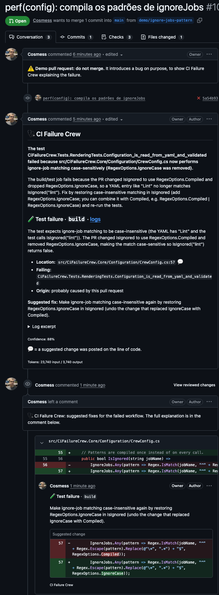
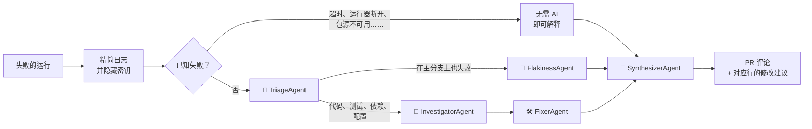

# CI Failure Crew

[English](README.md) | [Português](README.pt-BR.md) | **简体中文**

[](https://github.com/Cosmess/ci-failure-crew/actions/workflows/ci.yml)


当 Pull Request 的 CI 失败时，一组 **AI 智能体**会阅读任务日志和 diff，找出导致构建失败的代码行，并在 Pull Request
中发表评论：*“测试 X 失败，是因为第 Y 行的修改导致了 Z”*，同时附上可一键提交的修复建议。基于 .NET 10 和
[Microsoft Agent Framework](https://github.com/microsoft/agent-framework) 构建。



<sub>[演示 Pull Request](https://github.com/Cosmess/ci-failure-crew/pull/10) 上的真实解释：原因、对应的代码行以及一键修复。</sub>

## 工作原理



| 智能体 | 职责 |
|---|---|
| **TriageAgent** | 对失败进行分类：编译、测试、不稳定的测试、依赖、基础设施、超时或配置 |
| **FlakinessAgent** | 当该任务在默认分支上也失败时，判断是测试不稳定还是修改导致了失败 |
| **InvestigatorAgent** | 将错误与导致它的 diff 行关联起来，必要时读取代码仓库 |
| **FixerAgent** | 提出最小的修复，并根据日志中的预期值进行核对；单行修复会以修改建议的形式发布 |
| **SynthesizerAgent** | 针对所有失败的任务写出一句话总结 |

只会调用该失败真正需要的智能体。原因已知的失败（任务超时、运行器断开、磁盘已满、内存不足、包源不可用、请求频率限制）
由规则直接解释，**无需调用模型**。

## 功能特性

- **定位到行**：评论会显示原因所在的文件和行号，并说明是否由此 Pull Request 引起。
- **一键修复**：能在 diff 的一行内完成的修复会以 GitHub 修改建议的形式发布。
- **每个工作流一条评论**：每次运行都会更新同一条评论而不是不断新增，CI 再次通过时会标记为已解决。
- **识别不稳定的测试**：与同一任务在默认分支上的近期运行进行比较。
- **精简且安全的上下文**：日志只保留关键的行，GitHub 未屏蔽的密钥会在发送给模型或写入评论之前被隐藏。
- **对 fork 安全**：基于 `workflow_run` 运行，从不检出或执行 Pull Request 的代码。
- **通过 MCP 获取仓库上下文**：智能体可以通过只读的 MCP 服务器读取文件和搜索代码。
- **多语言**：解释支持英语（默认）、巴西葡萄牙语和简体中文。
- **启动快**：在 Linux 运行器上，Action 会拉取预构建镜像，几秒内即可启动。
- **质量可度量**：基于带标注的失败运行的评估套件。
- **不绑定模型提供商的命令行**：默认使用 OpenAI，同时支持 Anthropic Claude 和 Ollama。

## 快速开始（GitHub Action）

1. 在仓库中添加 `OPENAI_API_KEY` secret（*Settings → Secrets and variables → Actions*）。
2. 创建 `.github/workflows/ci-failure-crew.yml`，并在 `workflows` 中填写要监视的工作流名称：

```yaml
name: CI Failure Crew

on:
  workflow_run:
    workflows: [CI]
    types: [completed]

permissions:
  actions: read
  contents: read
  pull-requests: write

jobs:
  explain:
    if: github.event.workflow_run.event == 'pull_request' && github.event.workflow_run.conclusion != 'cancelled'
    runs-on: ubuntu-latest
    steps:
      - uses: actions/checkout@v4   # 默认分支，从不检出 Pull Request 的代码
      - uses: Cosmess/ci-failure-crew@v1
        with:
          openai-api-key: ${{ secrets.OPENAI_API_KEY }}
          language: zh-CN   # en、pt-BR 或 zh-CN
```

`workflow_run` 工作流只会从默认分支运行，因此请先将此文件合并，再在 Pull Request 上测试。

| 输入 | 默认值 | 说明 |
|---|---|---|
| `openai-api-key` | 必填 | OpenAI API 密钥 |
| `github-token` | `github.token` | 用于读取运行及其日志并在 Pull Request 中评论的令牌 |
| `model` | `gpt-5-mini` | OpenAI 模型 |
| `language` | `en` | 解释语言：`en`、`pt-BR` 或 `zh-CN` |
| `config` | `.ci-failure-crew.yml` | 配置文件（不存在时忽略） |
| `run-id` | 触发本工作流的运行 | 要解释的工作流运行 |
| `post-comment` | `true` | 在 Pull Request 中评论，CI 通过后标记为已解决 |
| `read-repository` | `true` | 为智能体提供只读的仓库 MCP 工具 |

更多内容（多个工作流、私有仓库、fork 和其他运行器）请参阅 [GitHub Action 指南](docs/zh-CN/guides/github-action.md)。

## 命令行

环境要求：[.NET 10 SDK](https://dotnet.microsoft.com/download) 和 [OpenAI API 密钥](https://platform.openai.com/api-keys)。

```bash
git clone https://github.com/Cosmess/ci-failure-crew.git
cd ci-failure-crew
export OPENAI_API_KEY=sk-...

# 用中文解释一个日志以及导致失败的 diff
dotnet run --project src/CiFailureCrew.Cli -- --log samples/test.log --diff samples/test.diff --language zh-CN

# 解释某个仓库中失败的运行，并在其 Pull Request 中评论（需要 GITHUB_TOKEN）
dotnet run --project src/CiFailureCrew.Cli -- --run 1234567890 --repo owner/repo --post
```

| 选项 | 说明 |
|---|---|
| `--run <id>` | 要解释的工作流运行（需要具有 `actions: read` 权限的 `GITHUB_TOKEN`） |
| `--repo <owner/name>` | 运行所在的仓库（默认：`GITHUB_REPOSITORY`） |
| `--post` | 在该运行的 Pull Request 中评论；如果运行已通过，则将评论标记为已解决 |
| `--log <文件>` | 要解释的任务日志，替代 `--run`；可重复使用以指定多个任务 |
| `--diff <文件>` | 修改的 diff，与 `--log` 一起使用 |
| `--language <代码>` | 解释语言：`en`、`pt-BR` 或 `zh-CN` |
| `--repo-path <目录>` | 为智能体提供读取文件和搜索代码的 MCP 工具 |
| `--config <文件>` | 配置文件（默认：存在时使用 `.ci-failure-crew.yml`） |
| `--output <文件>` | 将解释保存为 Markdown |

| 环境变量 | 默认值 | 说明 |
|---|---|---|
| `OPENAI_API_KEY` | | OpenAI API 密钥（默认提供商） |
| `CFC_PROVIDER` | `openai` | `openai`、`ollama` 或 `anthropic` |
| `CFC_MODEL` | `gpt-5-mini` | 模型 id（如 `gpt-5-mini`、`qwen3:8b`、`claude-sonnet-5-5`） |
| `GITHUB_TOKEN` | | 使用 `--run` 时必需 |
| `ANTHROPIC_API_KEY` | | 当 `CFC_PROVIDER=anthropic` 时使用的 Anthropic 密钥 |
| `OLLAMA_ENDPOINT` | `http://localhost:11434` | Ollama 服务器地址 |
| `OTEL_EXPORTER_OTLP_ENDPOINT` | | 通过 OTLP 导出追踪和指标 |

## 配置（`.ci-failure-crew.yml`）

```yaml
language: zh-CN
maxJobs: 3              # 每次运行分析的失败任务数，其余的只列出
ignoreJobs: ["deploy*"] # 从不分析的任务名称（* 匹配任意文本）
historyRuns: 10         # 用于识别不稳定任务的默认分支近期运行数（0 表示关闭）
maxLogChars: 20000
maxDiffChars: 40000
agentTimeoutSeconds: 180
maxRetries: 2
pricing:                # 每 100 万 token 的美元价格，用于估算费用
  inputPerMillion: 0.25
  outputPerMillion: 2.00
```

所有选项都在 [`.ci-failure-crew.example.yml`](.ci-failure-crew.example.yml) 中有说明。

## 评估

我们在 11 个带标注的失败运行上评估这组智能体：编译错误、.NET 和 Jest 测试失败、代码格式、配置、依赖、一个不稳定的测试
以及基础设施故障。

| 指标 | 英文 | 葡萄牙文 |
|---|---|---|
| 分类 | 100%（11 / 11） | 100%（11 / 11） |
| 定位到根本原因（文件和行号） | 100%（7 / 7） | 100%（7 / 7） |
| 来源（是否由 Pull Request 引起） | 100%（11 / 11） | 100%（11 / 11） |
| 无需 AI 解释的已知失败 | 100%（3 / 3） | 100%（3 / 3） |
| **完全正确的任务** | **100%（11 / 11）** | **100%（11 / 11）** |

<sub>`gpt-5-mini`，2026 年 10 月，每次运行约 3,000 个输入 token 和 2,000 个输出 token。</sub>

这些用例由维护者编写，比真实的 CI 日志更干净，因此满分只说明这组智能体能处理常见的失败，并不代表它总是正确。
该套件不评估修复建议本身：在 `samples/` 中的示例上，FixerAgent 学会根据日志中的预期值核对修复之后，3 次运行全部正确
（之前为 2 次中 1 次正确）。欢迎贡献更多、更难的用例。

你可以通过 `dotnet run --project src/CiFailureCrew.Evals` 或 **Evaluation** 工作流自行运行。详见
[`evals/README.zh-CN.md`](evals/README.zh-CN.md)。

## 安全

- Action 基于 `workflow_run` 运行：使用默认分支的代码和 secret，从不检出或执行 Pull Request 的代码，因此来自 fork 的
  Pull Request 是安全的。
- 日志和 diff 在发送给模型之前会隐藏令牌、密钥、私钥和密码。
- 日志、diff 和文件都被视为数据，而不是指令；仓库工具是只读的，并且限制在仓库范围内。
- 评论不会提及任何用户：模型写出的 `@名称` 会被中和。

如需报告漏洞，请参阅 [SECURITY.md](SECURITY.md)。

## 项目结构

```
src/
  CiFailureCrew.Core/       日志分析、智能体、编排、GitHub、配置、多语言和渲染
  CiFailureCrew.Providers/  创建 LLM 客户端（OpenAI、Anthropic、Ollama）
  CiFailureCrew.Cli/        命令行、MCP 工具和 OTLP 导出
  CiFailureCrew.McpServer/  提供仓库工具的只读 MCP 服务器
  CiFailureCrew.Evals/      评估运行器
evals/cases/                带标注的失败运行
samples/                    一个失败的测试日志以及导致失败的 diff
tests/                      单元测试（无网络）和集成测试（真实模型）
docs/                       英文、葡萄牙文和中文文档，以及 ADR
action.yml                  GitHub Action
Dockerfile                  Action 在 Linux 运行器上使用的预构建镜像
AGENTS.md                   在本仓库中工作的 AI 智能体需遵守的规则
```

## 文档

- [文档索引](docs/zh-CN/README.md)：架构、编码规范、测试和指南
- [架构决策记录](docs/adr/)（英文）

## 路线图

- [x] 已知失败规则、分类、不稳定性检查、调查和修复
- [x] Pull Request 中的固定评论、一键修改建议，以及 CI 通过后自动标记为已解决
- [x] 带预构建镜像的 GitHub Action
- [x] 基于带标注失败运行的评估套件
- [x] 支持英语、葡萄牙语和中文的解释
- [ ] 更多日志格式（Gradle、Maven、Go、Rust）和更多已知失败规则
- [ ] 修复涉及多行时自动创建包含修复的 Pull Request

## 相关项目

[Code Review Crew](https://github.com/Cosmess/code-review-crew)：将同样的思路应用于代码审查，包含安全、OWASP、性能和代码风格智能体。

## 参与贡献

欢迎贡献：请参阅 [CONTRIBUTING.md](CONTRIBUTING.md)（英文）。请按照 [SECURITY.md](SECURITY.md) 中的说明私下报告漏洞。
各版本的变更记录见 [更新日志](CHANGELOG.md)。

## 许可证

[MIT](LICENSE)
