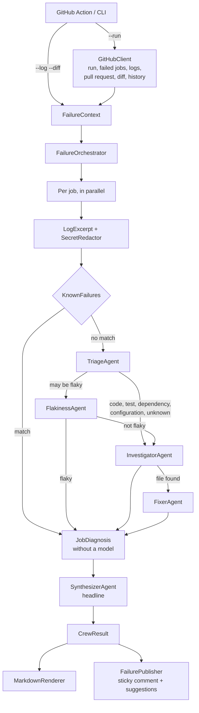

# Architecture

**English** | [Português](../pt-BR/architecture.md) | [简体中文](../zh-CN/architecture.md)

## Flow

## Pieces

### Log analysis (`Core/LogAnalysis`), no model

A job log can have tens of thousands of lines. Before any agent sees it:

- **`LogCleaner`** removes the timestamp GitHub adds to every line and ANSI colors, and isolates the step that failed:
  from the `##[group]Run` header before the first `##[error]` line to the end of that step.
- **`LogExcerpt`** keeps windows around error patterns (MSBuild and NuGet diagnostics, `dotnet test`, exceptions,
  Jest, pytest, Go) plus the end of the step, within `maxLogChars`. When it is too long it keeps the first errors,
  usually the root cause, and the end.
- **`SecretRedactor`** hides what GitHub did not mask: token formats, private keys, `Bearer` headers and
  `password=`-style assignments. It also runs on the diff.
- **`KnownFailures`** recognizes failures whose cause is never the code (job timeout, runner lost, disk full, out
  of memory, package feed down, rate limits) and explains them in every language without calling a model. Rules
  never apply when the step shows a failed test or a compiler error: test output can contain these messages, and the
  runner even turns a `##[error]` printed by a test into a line of its own. Lines of tests that passed are ignored.

Note: the folder is `LogAnalysis` because the standard .NET `.gitignore` ignores folders named `Logs`.

### Orchestration (`Core/Orchestration/FailureOrchestrator`)

Each failed job (up to `maxJobs`, minus `ignoreJobs`) goes through a pipeline that only calls the agents it needs:

1. A known failure ends the pipeline: no model is called.
2. **TriageAgent** classifies the failure, lists the failing tests or error codes and suggests a next step.
3. If the job may be flaky (triaged as flaky, or it also failed on the default branch), **FlakinessAgent**
   decides. A flaky job ends here.
4. For compilation, test, dependency, configuration and unknown failures, **InvestigatorAgent** connects the error
   to a file and line, preferring a line of the diff, and says whether the pull request caused it.
5. With a file, **FixerAgent** proposes the fix. Code that replaces exactly the root cause line is kept as a
   suggestion; anything else is dropped.

Jobs run in parallel. Then **SynthesizerAgent** writes the headline over all jobs; when every job was a known
failure the headline comes from the rule, so the run costs nothing.

Every call goes through `RetryPolicy` (timeout per attempt and exponential backoff). A failed agent never fails
the explanation: the diagnosis keeps what the previous agents found and lists the failure in `Errors`; if the
triage fails, the comment says so and still shows the log excerpt.

The agents receive the diff with the **line number of the new file written on every line** (`DiffAnnotator`),
because models miscount lines from hunk headers.

### GitHub (`Core/GitHub`)

- **`GitHubClient`** reads the run, the jobs of its latest attempt, job logs (following the redirect to the signed
  URL), the pull request (for forks, by owner and branch, because GitHub does not link them to the run), the diff
  and the job history on the default branch.
- **`FailurePublisher`** keeps one comment per workflow, identified by a hidden marker in its first line
  (`<!-- ci-failure-crew:workflow=<id> sha=<commit> ... -->`). Each run updates it. Suggestions are posted as a
  `COMMENT` review once per commit, and only on lines of the diff, the only lines GitHub accepts. When the
  workflow passes again, the comment is marked resolved and the old diagnosis is folded.

### Rendering (`Core/Rendering`)

`MarkdownRenderer` writes the comment in the result's language. Text from the model goes through
`MarkdownText.Safe`, which breaks `@mentions`, and code goes through `MarkdownText.Fence`, which picks a fence
longer than any backticks inside.

### Projects

- **`CiFailureCrew.Core`** depends only on `Microsoft.Agents.AI` and `Microsoft.Extensions.AI` abstractions and
  YamlDotNet. It does not reference provider SDKs.
- **`CiFailureCrew.Providers`** creates the `IChatClient` for OpenAI, Anthropic or Ollama, with OpenTelemetry.
- **`CiFailureCrew.Cli`** (`cfc`) does composition and I/O, starts the MCP server and exports telemetry.
- **`CiFailureCrew.McpServer`** is a separate process speaking MCP over stdio, with read-only tools confined to the
  repository.
- **`CiFailureCrew.Evals`** runs the crew over `evals/cases` and scores it.
- **`action.yml`** turns the inputs into CLI arguments. On Linux runners it runs the CLI from the prebuilt image;
  elsewhere it builds the CLI from source (see [ADR 0006](../adr/0006-prebuilt-container-image.md)).

## Structured output

Every agent returns JSON deserialized into a record (`Triage`, `Investigation`, `FlakinessAssessment`,
`FixProposal`, `Headline`) through `RunAsync<T>`. The orchestrator never parses free text.

## Telemetry

`CrewTelemetry` defines the `CiFailureCrew` activity source and meter: an `explain_failure` span, one
`invoke_agent <name>` span per agent call with the job as a tag, and the metrics `cfc.tokens.input`,
`cfc.tokens.output`, `cfc.diagnoses` (by category and source), `cfc.agent.failures` and `cfc.agent.duration`.
The CLI exports them through OTLP when `OTEL_EXPORTER_OTLP_ENDPOINT` is set.
