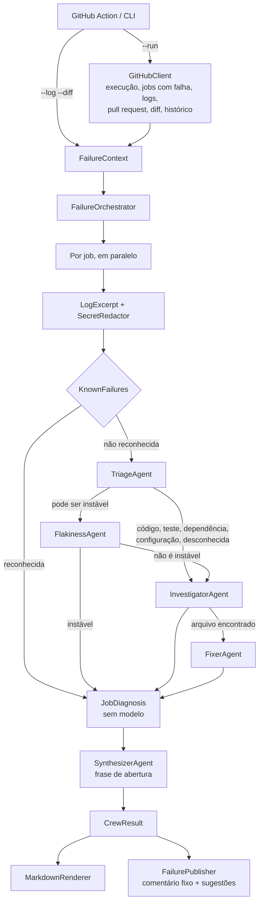

# Arquitetura

[English](../en/architecture.md) | **Português** | [简体中文](../zh-CN/architecture.md)

## Fluxo

## Peças

### Análise de logs (`Core/LogAnalysis`), sem modelo

Um log de job pode ter dezenas de milhares de linhas. Antes de qualquer agente vê-lo:

- **`LogCleaner`** remove o timestamp que o GitHub coloca em cada linha e as cores ANSI, e isola o passo que falhou:
  do cabeçalho `##[group]Run` antes da primeira linha `##[error]` até o fim desse passo.
- **`LogExcerpt`** mantém janelas em volta de padrões de erro (diagnósticos do MSBuild e do NuGet, `dotnet test`,
  exceções, Jest, pytest, Go) mais o fim do passo, dentro de `maxLogChars`. Quando passa do limite, mantém os
  primeiros erros, que costumam ser a causa raiz, e o fim.
- **`SecretRedactor`** oculta o que o GitHub não mascarou: formatos de token, chaves privadas, cabeçalhos `Bearer` e
  atribuições como `password=`. Também roda sobre o diff.
- **`KnownFailures`** reconhece falhas cuja causa nunca é o código (timeout do job, runner perdido, disco cheio,
  falta de memória, feed de pacotes fora do ar, limite de taxa) e as explica em todos os idiomas sem chamar o modelo.

Observação: a pasta se chama `LogAnalysis` porque o `.gitignore` padrão do .NET ignora pastas chamadas `Logs`.

### Orquestração (`Core/Orchestration/FailureOrchestrator`)

Cada job com falha (até `maxJobs`, menos os de `ignoreJobs`) passa por um pipeline que só chama os agentes de que
precisa:

1. Uma falha conhecida encerra o pipeline: nenhum modelo é chamado.
2. O **TriageAgent** classifica a falha, lista os testes ou códigos de erro e sugere um próximo passo.
3. Se o job pode ser instável (triado como instável, ou também falhou na branch padrão), o **FlakinessAgent**
   decide. Um job instável termina aqui.
4. Em falhas de compilação, teste, dependência, configuração e desconhecidas, o **InvestigatorAgent** liga o erro a
   um arquivo e uma linha, de preferência uma linha do diff, e diz se o pull request causou a falha.
5. Com um arquivo, o **FixerAgent** propõe a correção. Código que substitui exatamente a linha da causa raiz vira
   sugestão; o resto é descartado.

Os jobs rodam em paralelo. Depois, o **SynthesizerAgent** escreve a frase de abertura sobre todos os jobs; quando
todos foram falhas conhecidas, a frase vem da regra, e a execução não custa nada.

Toda chamada passa pela `RetryPolicy` (timeout por tentativa e backoff exponencial). Um agente que falha nunca
derruba a explicação: o diagnóstico mantém o que os agentes anteriores acharam e lista a falha em `Errors`; se a
triagem falhar, o comentário avisa e ainda mostra o trecho do log.

Os agentes recebem o diff com o **número da linha no arquivo novo escrito em cada linha** (`DiffAnnotator`), porque
os modelos erram a contagem a partir dos cabeçalhos dos hunks.

### GitHub (`Core/GitHub`)

- **`GitHubClient`** lê a execução, os jobs da última tentativa, os logs dos jobs (seguindo o redirecionamento para
  a URL assinada), o pull request (em forks, pelo dono e branch, porque o GitHub não os liga à execução), o diff e o
  histórico dos jobs na branch padrão.
- **`FailurePublisher`** mantém um comentário por workflow, identificado por um marcador oculto na primeira linha
  (`<!-- ci-failure-crew:workflow=<id> sha=<commit> ... -->`). Cada execução o atualiza. As sugestões vão numa revisão
  `COMMENT` uma vez por commit, e só em linhas do diff, as únicas que o GitHub aceita. Quando o workflow volta a
  passar, o comentário é marcado como resolvido e o diagnóstico anterior é recolhido.

### Renderização (`Core/Rendering`)

O `MarkdownRenderer` escreve o comentário no idioma do resultado. Texto do modelo passa pelo `MarkdownText.Safe`,
que quebra `@menções`, e código passa pelo `MarkdownText.Fence`, que escolhe uma cerca maior que qualquer sequência
de crases no texto.

### Projetos

- **`CiFailureCrew.Core`** só depende das abstrações `Microsoft.Agents.AI` e `Microsoft.Extensions.AI` e do
  YamlDotNet. Não referencia SDKs de provedores.
- **`CiFailureCrew.Providers`** cria o `IChatClient` da OpenAI, Anthropic ou Ollama, com OpenTelemetry.
- **`CiFailureCrew.Cli`** (`cfc`) faz composição e I/O, inicia o servidor MCP e exporta telemetria.
- **`CiFailureCrew.McpServer`** é um processo separado que fala MCP por stdio, com ferramentas somente leitura
  confinadas ao repositório.
- **`CiFailureCrew.Evals`** roda a equipe sobre `evals/cases` e calcula as métricas.
- **`action.yml`** transforma os inputs em argumentos da CLI. Em runners Linux, roda a CLI a partir da imagem
  pronta; nos demais, compila a CLI a partir do código (veja o [ADR 0006](../adr/0006-prebuilt-container-image.md)).

## Saída estruturada

Cada agente devolve JSON desserializado num record (`Triage`, `Investigation`, `FlakinessAssessment`,
`FixProposal`, `Headline`) via `RunAsync<T>`. O orquestrador nunca interpreta texto livre.

## Telemetria

O `CrewTelemetry` define o activity source e o meter `CiFailureCrew`: um span `explain_failure`, um span
`invoke_agent <nome>` por chamada de agente com o job como tag, e as métricas `cfc.tokens.input`,
`cfc.tokens.output`, `cfc.diagnoses` (por categoria e origem), `cfc.agent.failures` e `cfc.agent.duration`. A CLI
as exporta via OTLP quando `OTEL_EXPORTER_OTLP_ENDPOINT` está definido.
