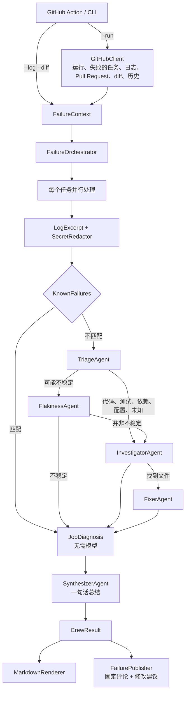

# 架构

[English](../en/architecture.md) | [Português](../pt-BR/architecture.md) | **简体中文**

## 流程

## 组件

### 日志分析（`Core/LogAnalysis`），无需模型

一个任务日志可能有数万行。在任何智能体看到它之前：

- **`LogCleaner`** 删除 GitHub 为每行添加的时间戳和 ANSI 颜色，并截取失败的步骤：从第一个 `##[error]` 行之前的
  `##[group]Run` 标题开始，到该步骤结束为止。
- **`LogExcerpt`** 保留错误模式周围的窗口（MSBuild 和 NuGet 诊断、`dotnet test`、异常、Jest、pytest、Go）以及步骤末尾，
  总长度不超过 `maxLogChars`。超出时，保留通常就是根本原因的前几个错误以及末尾部分。
- **`SecretRedactor`** 隐藏 GitHub 未屏蔽的内容：各种令牌格式、私钥、`Bearer` 请求头以及 `password=` 之类的赋值。
  它同样作用于 diff。
- **`KnownFailures`** 识别原因从不在代码中的失败（任务超时、运行器断开、磁盘已满、内存不足、包源不可用、请求频率限制），
  并在不调用模型的情况下用所有语言进行解释。

注意：该文件夹名为 `LogAnalysis`，因为 .NET 默认的 `.gitignore` 会忽略名为 `Logs` 的文件夹。

### 编排（`Core/Orchestration/FailureOrchestrator`）

每个失败的任务（最多 `maxJobs` 个，不包括 `ignoreJobs` 中的任务）都会经过一个只调用所需智能体的流水线：

1. 已知失败直接结束流水线：不调用任何模型。
2. **TriageAgent** 对失败进行分类，列出失败的测试或错误代码，并建议下一步。
3. 如果任务可能不稳定（被分类为不稳定，或在默认分支上也失败过），由 **FlakinessAgent** 判断。不稳定的任务到此结束。
4. 对于编译、测试、依赖、配置和未知的失败，**InvestigatorAgent** 将错误与某个文件和行关联起来（优先选择 diff 中的行），
   并说明是否由此 Pull Request 引起。
5. 找到文件后，**FixerAgent** 提出修复。只有恰好替换根本原因所在行的代码才会保留为修改建议，其他的都会被丢弃。

各任务并行处理。随后 **SynthesizerAgent** 针对所有任务写出一句话总结；如果所有任务都是已知失败，总结直接来自规则，
整个过程没有任何费用。

每次调用都经过 `RetryPolicy`（每次尝试都有超时，并采用指数退避）。智能体失败不会导致整个解释失败：诊断会保留前面智能体
的结论，并在 `Errors` 中列出失败；如果分类失败，评论会说明这一点，并仍然展示日志摘录。

智能体收到的 diff 中**每一行都写有其在新文件中的行号**（`DiffAnnotator`），因为模型根据 hunk 标题计算行号时容易出错。

### GitHub（`Core/GitHub`）

- **`GitHubClient`** 读取运行、其最新一次尝试中的任务、任务日志（跟随重定向到签名 URL）、Pull Request（对于 fork，
  按所有者和分支查找，因为 GitHub 不会将它们关联到运行）、diff 以及任务在默认分支上的历史。
- **`FailurePublisher`** 为每个工作流维护一条评论，通过第一行中的隐藏标记识别
  （`<!-- ci-failure-crew:workflow=<id> sha=<commit> ... -->`）。每次运行都会更新它。修改建议以 `COMMENT` 审查的形式
  每个提交发布一次，并且只发布在 diff 中的行上，因为 GitHub 只接受这些行。工作流再次通过时，评论会被标记为已解决，
  之前的诊断会被折叠。

### 渲染（`Core/Rendering`）

`MarkdownRenderer` 使用结果的语言撰写评论。来自模型的文本会经过 `MarkdownText.Safe`，以中和 `@提及`；代码会经过
`MarkdownText.Fence`，它会选择比文本中任何反引号序列都长的围栏。

### 项目

- **`CiFailureCrew.Core`** 只依赖 `Microsoft.Agents.AI` 和 `Microsoft.Extensions.AI` 抽象以及 YamlDotNet，不引用任何
  模型提供商的 SDK。
- **`CiFailureCrew.Providers`** 为 OpenAI、Anthropic 或 Ollama 创建 `IChatClient`，并接入 OpenTelemetry。
- **`CiFailureCrew.Cli`**（`cfc`）负责组装和 I/O，启动 MCP 服务器并导出遥测数据。
- **`CiFailureCrew.McpServer`** 是一个通过 stdio 使用 MCP 通信的独立进程，提供限制在仓库范围内的只读工具。
- **`CiFailureCrew.Evals`** 在 `evals/cases` 上运行这组智能体并计算指标。
- **`action.yml`** 将输入转换为 CLI 参数。在 Linux 运行器上，它使用预构建镜像运行 CLI；在其他运行器上则从源码构建 CLI
  （参见 [ADR 0006](../adr/0006-prebuilt-container-image.md)）。

## 结构化输出

每个智能体都通过 `RunAsync<T>` 返回 JSON，并反序列化为一个 record（`Triage`、`Investigation`、`FlakinessAssessment`、
`FixProposal`、`Headline`）。编排器从不解析自由文本。

## 遥测

`CrewTelemetry` 定义了 `CiFailureCrew` 的 activity source 和 meter：一个 `explain_failure` span、每次智能体调用对应一个
以任务为标签的 `invoke_agent <名称>` span，以及指标 `cfc.tokens.input`、`cfc.tokens.output`、`cfc.diagnoses`（按分类和
来源）、`cfc.agent.failures` 和 `cfc.agent.duration`。设置 `OTEL_EXPORTER_OTLP_ENDPOINT` 后，CLI 会通过 OTLP 导出它们。
